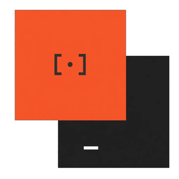
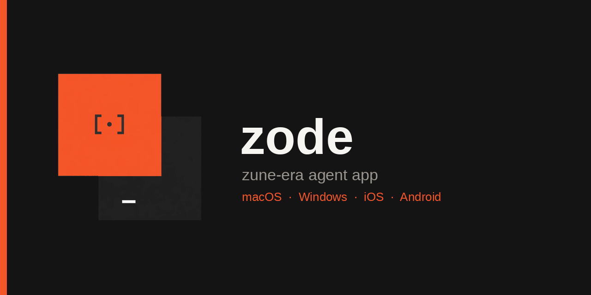
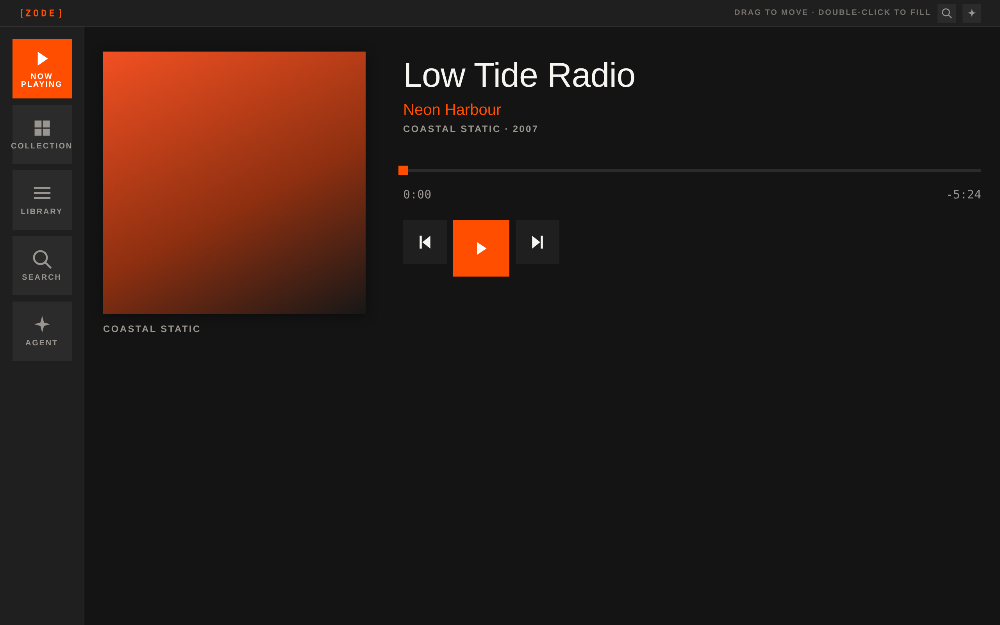
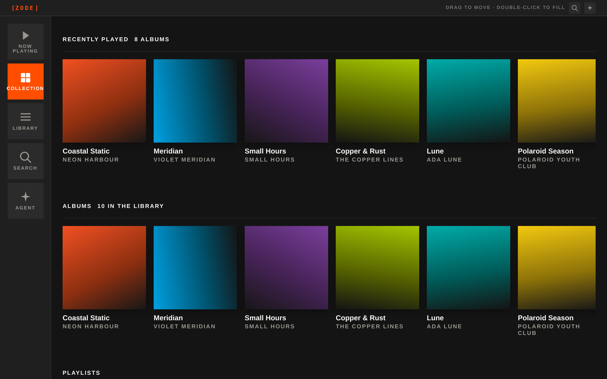

<div align="center">



# zode

**A Zune-era agent app — native shells, a Metro web app, and mobile clients.**

One product, five surfaces, one contract.

</div>

---

## What this is

Zode is a music-and-agent app with the visual language of the original Zune (2006–2011) and
Microsoft's Metro design language: flat square tiles, a near-black or warm-paper canvas,
Segoe-style light display type, uppercase tracked labels, and fast "reveal" motion.

The desktop apps are **native shells** that render the web app in the **system webview** —
`WKWebView` on macOS, **Edge WebView2** on Windows — with **no native window controls at all**.
The window chrome is the app's own cards and typography. The single concession is a **34 px drag
strip across the top** so the window can be moved, and a **double-click on that strip fills the
screen with this app window**.

<p align="center">
  
</p>

<p align="center">
  <em>Now Playing &nbsp;·&nbsp; Collection &nbsp;·&nbsp; Agent</em>
</p>

<p align="center">
  
  
</p>

## Why it is shaped like this

Every platform speaks the **same frozen contract** (`packages/shared/contract.md`). The web app
never touches a platform transport directly; it only calls `window.zode`. Each shell installs a
thin adapter that maps that API onto its own transport.

```
                    ┌──────────────────────────────┐
                    │   apps/web  (zero-dep ESM)    │
                    │   window.zode  —  contract v1 │
                    └───────────────┬──────────────┘
                                    │  message envelope
              ┌─────────────────────┼─────────────────────┐
              │                     │                     │
     ┌────────▼────────┐  ┌─────────▼─────────┐  ┌────────▼────────┐
     │  macOS shell    │  │  Windows shell    │  │  mobile clients │
     │  WKWebView      │  │  WebView2         │  │  SwiftUI/Compose│
     │  CoreHaptics    │  │  Win32 + waveOut  │  │  CoreHaptics /  │
     │  App Intents    │  │  App Actions      │  │  VibrationEffect│
     └─────────────────┘  └───────────────────┘  └─────────────────┘
```

**Haptics are defined once.** `packages/shared/haptics.json` holds waveform *programs* —
event lists with intensity and sharpness curves. Each platform renders that same program with
the best engine it has, so the triple-roll "done" and the tiny slow "working" wave feel
identical everywhere.

## Repository layout

```
zode/
├── packages/shared/          ← the single source of truth (frozen)
│   ├── contract.md           native bridge contract v1
│   ├── haptics.json          haptic waveform programs
│   ├── library.json          the canonical library — every platform presents these records
│   └── tokens.css            design tokens (colour, type, metrics)
├── apps/web/                 ← the Zune/Metro web app the shells host
│                              zero dependencies, no build step, plain ES modules
├── shells/macos/             ← SwiftUI + WKWebView native shell
├── shells/windows/           ← Win32 + WebView2 native shell
├── mobile/ios/               ← SwiftUI Metro client
├── mobile/android/           ← Jetpack Compose Metro client
├── icons/                    ← every native icon variant, generated by make_icons.py
├── docs/                     ← platform notes + rendered screenshots
└── scripts/                  ← publish, verify, icon generation, screenshot capture
```

### One library, every platform

The web app owns the records. `scripts/dump_library.mjs` imports it directly and publishes
`packages/shared/library.json` — 9 artists, 10 albums, 50 tracks, 3 playlists, with ids,
durations, track numbers and accent colours. Both mobile clients read that file from their
bundle; neither invents its own catalogue.

```bash
python3 scripts/export_library.py           # publish
python3 scripts/export_library.py --check   # verify every copy agrees
```


## The window rules

Both desktop shells obey the same five rules, defined in contract §5:

1. **No native window controls.** No traffic lights, no minimise, no maximise, no close, no
   title bar. The app's own content owns the entire window.
2. **The web content owns every pixel** of the client area — the shell paints no background,
   border, or shadow over it.
3. **The top 34 px is a drag zone.** `pointerdown` there starts a *real* OS window drag
   (`NSWindow.performDrag` on macOS, `WM_NCLBUTTONDOWN`/`HTCAPTION` on Windows).
4. **Double-clicking the drag zone fills the screen with this app window** — the *entire
   display bounds*, not the work area, and deliberately **not** OS fullscreen (the menu bar and
   Spaces stay put).
5. **Nothing below the strip moves the window.**

## Platform capability matrix

Honest about what each platform can actually do:

| Capability | macOS 27 | Windows 11 | iOS | Android | Web |
|---|:--:|:--:|:--:|:--:|:--:|
| System webview | `WKWebView` | WebView2 | `WKWebView` | WebView | browser |
| Rich haptics | ⚠️ audio fallback¹ | ⚠️ audio fallback² | ✅ Taptic Engine | ✅ vibrator | ⚠️ WebAudio |
| Drop file anywhere on window | ✅ | ✅ | — | — | ✅ picker |
| Drop on app icon | ✅ Dock | ✅ taskbar | — | — | — |
| System search | ✅ Spotlight | ⚠️ MSIX only³ | ✅ Spotlight | ✅ AppSearch | in-app |
| System intents | ✅ App Intents + Media Intents | ✅ App Actions (MSIX) | ✅ App Intents | ✅ intents | in-app |
| Notifications | ✅ | ✅ (needs AUMID) | ✅ | ✅ | ⚠️ browser |
| System journal | ✅ Journaling Suggestions | ❌ none⁴ | ✅ | ❌ none⁴ | ❌ none⁴ |
| Signing | Developer ID / Apple ID | none required⁵ | Apple ID | upload key | — |

¹ Macs have **no Taptic Engine**. `CoreHaptics` exists on macOS 10.15+, but
`CHHapticEngine.capabilitiesForHardware().supportsHaptics` is false on most hardware, so Zode
synthesises the same waveform as audio and reports `capabilities.haptics = false`.

² Windows desktops have **no rich haptic API** — only `IVibrationDevice`, a coarse pulse. Zode
synthesises the waveform through `waveOut` so the *shape* survives, and additionally fires a
coarse vibration when the hardware supports one.

³ App Actions and App Content Search require **package identity**, so those paths need the
MSIX build. The unpackaged build still works; the manifest and `appactions.json` are shipped in
`shells/windows/msix/`.

⁴ Windows and Android have no system journal equivalent. `journal.write` resolves successfully
and lands in a local activity log (`%LOCALAPPDATA%\Zode\journal.jsonl`) instead.

⁵ The brief specifies **no Windows signing key**, so the default build is unpackaged and needs
none. Only the optional MSIX path wants a certificate.

## Building

### The web app (no build step)

```bash
cd apps/web
node serve.mjs            # http://127.0.0.1:5173
node selfcheck.mjs        # contract conformance self-test
```

No `npm install` — the app is plain ES modules with zero runtime dependencies, which is what
lets both shells bundle the folder verbatim.

### macOS shell

```bash
cd shells/macos
./sign.sh                 # list your codesigning identities
export ZODE_TEAM_ID=YOUR_TEAM_ID
./build.sh                # archive + export a signed .app
```

`build.sh` runs `xcodebuild archive` with `CODE_SIGN_STYLE=Automatic`,
`DEVELOPMENT_TEAM="$ZODE_TEAM_ID"` and `-allowProvisioningUpdates`, so your developer profile
is used automatically. The Xcode project is **generated**, not hand-written:

```bash
python3 tools/generate_xcodeproj.py     # deterministic; re-runs produce identical output
python3 tools/validate_pbxproj.py       # structural validation
```

For live development against the web app, set `ZODE_DEV_URL=http://127.0.0.1:5173` and the shell
loads your dev server instead of the bundled assets.

### Windows shell

```powershell
cd shells/windows
.\build.ps1               # unpackaged, no certificate required
.\build-msix.ps1          # optional: package identity for App Actions
```

The shell serves the web app from a virtual host (`https://app.zode.local/`) rather than
`file://`, so the origin is stable and the bridge is not subject to file-origin restrictions.

### Mobile

```bash
cd mobile/ios      # open ZodeMobile.xcodeproj in Xcode
cd mobile/android  # open in Android Studio, or ./gradlew :app:assembleDebug
```

> The Android `gradle-wrapper.jar` **is** committed, so `./gradlew` works straight out of
> a clone. Regenerate it with `gradle wrapper --gradle-version 8.11.1` if you need to.
> `local.properties` is gitignored — it points at your SDK.

## Icons

Every native icon variant is generated from the single source artwork in `icons/zode.png`:

```bash
python3 icons/make_icons.py
```

That produces `zode.icns` (macOS, squircle-masked with Apple's ~10% padding), `zode.ico`
(Windows, 16–256 px), the iOS 1024 px master, the Android adaptive foreground/background plus
all five mipmap densities, a favicon, and the 1280×640 GitHub social preview.

## Publishing

```bash
export GH_TOKEN=ghp_xxxxxxxx   # scope: repo
./scripts/publish-github.sh
```

Creates the public `zode` repository, pushes `main`, and points `origin` at it.

## Status

**Verified by actually building it:**

- The **Android client compiles and assembles** — `./gradlew :app:assembleDebug` produces a
  real APK (JDK 17 + Android SDK 36 + Gradle 8.11.1).
- The **web app boots and renders** — every view was captured in headless Chromium
  (`scripts/shoot-web.mjs`), the drag strip measures exactly 34 px, and `node selfcheck.mjs`
  passes 35/35 checks including the haptic wiring.
- The **Windows shell** passes 57/57 static checks plus a cross-check against the web app's
  own constants (request types, event names, error codes, attachment sources, intent names).
- The **macOS shell** passes a structural audit of the generated Xcode project and a
  cross-check of the contract's request types, intent names and error codes.
- Every generated Xcode project is **byte-deterministic** — re-running the generator produces
  an identical file.
- `Info.plist` / `Zode.entitlements` parse as plists; the MSIX manifest and `appactions.json`
  are valid XML/JSON and cover every intent.
- Icons regenerate byte-identically. No credential material is committed.

**Verified in CI, on real runners** — `.github/workflows/ci.yml` runs on genuine macOS,
Windows and Android machines and therefore does what a Linux authoring box cannot:

- `xcodebuild` **compiles** the macOS shell.
- `dotnet build` **compiles** the Windows shell.
- `xcodebuild` **compiles** the iOS client for the simulator.
- `./gradlew :app:assembleDebug` **assembles** the Android APK.

**Still needs a human with the hardware:**

- Runtime window behaviour — that the drag strip really moves the window with the right feel,
  that double-click really fills the display, that nothing below the strip moves the window.
- Whether the triple-roll "done" and the tiny slow "working" wave actually *sound* like a
  triple roll and a slow wave. The waveforms are correct as data; only ears can confirm them.
- Dock / taskbar drop end to end.
- Signing with a real developer profile.
- Siri, Spotlight, App Actions and the Journal integration end to end.

Each platform's `deliverable.md` separates *verified* from *not verified*. Read
[`docs/PLATFORM-NOTES.md`](docs/PLATFORM-NOTES.md) for the per-platform detail and
[`packages/shared/contract.md`](packages/shared/contract.md) for the full bridge specification.

## Verifying it yourself

```bash
./scripts/verify.sh        # every check that does not need a Mac / Windows box
```


## Licence

MIT — see [LICENSE](LICENSE).
